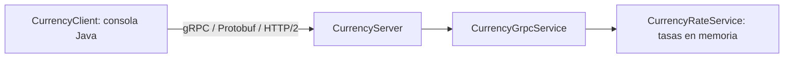

# CurrencyRPC

## STATUS

| Componente | Estado |
| --- | --- |
| Local | FUNCIONAL |
| Tests | 29/29 PASSED |
| Build | SUCCESS |
| Dockerfile | READY — no ejecutado localmente |
| Cloud deployment | DOCUMENTED / NOT EXECUTED — requisito de facturación |

## Inicio rápido

```shell
mvn clean package
```

Servidor: `java -jar target/currency-rpc.jar`

Cliente, en otra terminal: `java -cp target/currency-rpc.jar com.currencyrpc.client.CurrencyClient`

La demo muestra conversiones, cinco actualizaciones y dos errores esperados de validación. Para presentar: [guion de cuatro minutos](docs/demo.md), [preguntas de sustentación](docs/guia-sustentacion.md) y [despliegue simulado](docs/despliegue-simulado.md). Evidencia real: [tests](docs/evidencias/tests.txt) y [ejecución local](docs/evidencias/ejecucion-local.txt).

**Sistema distribuido de conversión de monedas utilizando gRPC y Protocol Buffers.**

Proyecto académico de Programación Orientada a la Web, séptimo semestre. Cliente Java de consola y servidor gRPC, sin base de datos, frontend, autenticación ni APIs externas. Las tasas son **fijas y simuladas**, no cotizaciones de mercado.

## Caso de estudio, problema y solución

Una empresa necesita convertir monedas desde distintas aplicaciones. Duplicar tasas y cálculos dificulta mantener resultados consistentes. CurrencyRPC centraliza la lógica en un servidor y publica un contrato `.proto` para generar clientes tipados.

## Objetivos

**General:** construir y verificar una aplicación distribuida con gRPC, preparada para contenedores y despliegue cloud.

- Definir RPC unary y server streaming mediante Protocol Buffers.
- Separar transporte, configuración y lógica monetaria.
- Validar entradas y comunicar errores con estados gRPC.
- Automatizar pruebas y demostrar cliente y servidor reales.
- Documentar arquitectura, Docker y Google Cloud Run.

## Tecnologías

Java 21, Maven 3.9+, gRPC Java 1.76.0 (`grpc-netty-shaded`, `grpc-protobuf`, `grpc-stub`), `protobuf-java` 3.25.8, JUnit 5 y Docker. `javax.annotation-api` permite compilar las anotaciones de los stubs generados. No se utiliza Spring.

## Arquitectura y conceptos



- **RPC:** solicitar una operación a otro proceso a través de la red.
- **gRPC:** genera stubs y gestiona llamadas, estados, cancelación y deadlines.
- **Protocol Buffers:** lenguaje de contrato y serialización binaria. Maven genera mensajes Java y stubs automáticamente.
- **HTTP/2:** transporte con streams multiplexados sobre una conexión, implementado aquí por Netty.
- **Unary RPC:** una solicitud y una respuesta; usado para convertir y listar monedas.
- **Server streaming:** una solicitud y varias respuestas; usado para enviar cinco tasas simuladas.

## Contrato y reglas

| RPC | Solicitud | Respuesta |
| --- | --- | --- |
| `ConvertCurrency` | Monedas origen/destino e importe | Monedas, importe original, convertido, tasa y mensaje |
| `GetSupportedCurrencies` | Mensaje vacío | Lista de códigos |
| `WatchExchangeRate` | Monedas origen/destino | Cinco tasas con secuencia y timestamp Unix en milisegundos |

Importes y tasas se representan como **strings decimales** para evitar aproximaciones binarias. Usar punto decimal, sin comas ni exponentes. El importe debe ser positivo, con hasta 18 dígitos enteros y 8 decimales. Los códigos se normalizan a mayúsculas y se recortan espacios. Una entrada inválida devuelve `INVALID_ARGUMENT`.

| Moneda | Unidades por 1 USD (simuladas) |
| --- | ---: |
| USD | 1 |
| COP | 4000 |
| EUR | 0.92 |
| GBP | 0.79 |
| JPY | 150 |
| MXN | 17 |

Fórmula: `resultado = importe × tasaDestino / tasaOrigen`. Se usa `BigDecimal`, redondeando una sola vez el resultado a dos decimales con `HALF_UP`. Es una convención académica uniforme, también para JPY. La tasa informativa tiene 12 decimales; un importe muy pequeño puede producir `0.00`.

Streaming aplica factores `1`, `1.001`, `0.999`, `1.002` y `1.0005`, sin modificar las tasas de conversión. Una moneda contra sí misma conserva tasa 1. La primera respuesta es inmediata y las siguientes esperan aproximadamente un segundo. Cada RPC usa un hilo virtual de Java 21; se comprueba cancelación antes de cada envío. El cliente tiene deadline de 30 segundos por llamada.

## Estructura

```text
pom.xml
Dockerfile
src/main/proto/currency.proto
src/main/java/com/currencyrpc/
  config/AppConfig.java
  server/CurrencyServer.java
  client/CurrencyClient.java
  service/CurrencyRateService.java
  service/CurrencyGrpcService.java
src/test/java/com/currencyrpc/
  CurrencyRateServiceTest.java
  CurrencyGrpcIntegrationTest.java
docs/informe.md
docs/arquitectura.md
```

## Compilar y probar

Requisitos: JDK 21 y Maven 3.9+ en `PATH`. La primera compilación necesita Maven Central.

```shell
mvn clean compile
mvn test
mvn clean package
```

El JAR con dependencias queda en `target/currency-rpc.jar`. Las clases generadas quedan en `target/generated-sources/protobuf`; no se editan ni se versionan. Las pruebas verifican conversiones, validación, estados gRPC y streaming sobre Netty/HTTP2 real en un puerto efímero. Reportes: `target/surefire-reports`.

**Verificado localmente:** `mvn clean compile`, `mvn test` y `mvn clean package` terminaron con `BUILD SUCCESS`: 29 pruebas, cero fallos. También se ejecutó el JAR con servidor y cliente en procesos separados y se recibieron las cinco actualizaciones. Véase la evidencia en el informe.

## Ejecutar servidor y cliente

Terminal 1 (Ctrl+C para apagar limpiamente):

```shell
java -jar target/currency-rpc.jar
```

Terminal 2:

```shell
java -cp target/currency-rpc.jar com.currencyrpc.client.CurrencyClient
```

La demostración lista seis monedas, convierte `100 USD -> 400000.00 COP` y `500000 COP -> 125.00 USD`, y muestra automáticamente `Update 1` a `Update 5`: 4000, 4004, 3996, 4008 y 4002 para USD/COP. También envía importe cero y moneda XYZ y comprueba que ambos devuelvan `INVALID_ARGUMENT`. No requiere argumentos.

### Variables de entorno

| Variable | Predeterminado | Uso |
| --- | --- | --- |
| `PORT` | `9090` | Servidor, escucha en `0.0.0.0` |
| `GRPC_HOST` | `localhost` | Host del cliente, sin esquema ni ruta |
| `GRPC_PORT` | `9090` | Puerto del cliente |
| `GRPC_TLS` | `false` | `true` para Cloud Run |

PowerShell, servidor y cliente en terminales distintas:

```powershell
$env:PORT = '9091'
java -jar target/currency-rpc.jar
```

```powershell
$env:GRPC_HOST = 'localhost'
$env:GRPC_PORT = '9091'
$env:GRPC_TLS = 'false'
java -cp target/currency-rpc.jar com.currencyrpc.client.CurrencyClient
```

Bash: `PORT=9091 java -jar target/currency-rpc.jar` y `GRPC_PORT=9091 java -cp target/currency-rpc.jar com.currencyrpc.client.CurrencyClient`.

## Docker

El Dockerfile compila y prueba con Maven/JDK 21, y ejecuta con JRE 21 como usuario sin privilegios. El contenedor recibe HTTP/2 sin TLS (h2c).

```shell
docker build -t currency-rpc:1.0 .
docker run --rm --name currency-rpc -p 9090:9090 currency-rpc:1.0
```

Ejecutar el cliente local en otra terminal. Detener con `docker stop currency-rpc`. Si 9090 ya está ocupado, detener el servidor previo o usar `-p 9091:9090` y `GRPC_PORT=9091`.

Para comprobar un puerto interno diferente:

```shell
docker run --rm -e PORT=8080 -p 9090:8080 currency-rpc:1.0
```

Dockerfile preparado pero no ejecutado localmente porque Docker no está disponible en el entorno.

## Despliegue en Google Cloud Run

Cloud Run admite gRPC y streaming. Habilitar HTTP/2 con `--use-http2`: Google termina TLS y el contenedor recibe h2c en `0.0.0.0:$PORT`. El cliente externo utiliza TLS y puerto 443. Véanse las fuentes oficiales de [HTTP/2](https://docs.cloud.google.com/run/docs/configuring/http2) y [gRPC](https://docs.cloud.google.com/run/docs/triggering/grpc).

**Estado: DOCUMENTED / NOT EXECUTED.** El despliegue real no se realizó por el requisito de vincular facturación; se decidió no ingresar tarjeta. La entrega utiliza una [simulación académica expresamente identificada](docs/despliegue-simulado.md), sin servicio activo ni URL pública real. Los comandos siguientes son una referencia futura, no se ejecutan durante la sustentación. Requerirían Google Cloud CLI, autenticación, proyecto con facturación y permisos. En ese caso, el servicio permitiría invocación pública si las políticas de la organización lo admiten.

Ejecutar en PowerShell desde la raíz, sustituyendo el ID de proyecto:

```powershell
$projectId = 'TU_PROJECT_ID'
$region = 'us-central1'
gcloud auth login
gcloud config set project $projectId
gcloud services enable run.googleapis.com cloudbuild.googleapis.com artifactregistry.googleapis.com
gcloud artifacts repositories create currency-rpc --repository-format=docker --location=$region
$imageUri = "${region}-docker.pkg.dev/${projectId}/currency-rpc/server:1.0.0"
gcloud builds submit --tag $imageUri .
gcloud run deploy currency-rpc --image $imageUri --region $region --platform managed --allow-unauthenticated --use-http2 --port 9090 --timeout 60 --memory 512Mi --cpu 1 --min-instances 0 --max-instances 2
$serviceUrl = gcloud run services describe currency-rpc --region $region --format='value(status.url)'
$env:GRPC_HOST = ([uri]$serviceUrl).Host
$env:GRPC_PORT = '443'
$env:GRPC_TLS = 'true'
java -cp target/currency-rpc.jar com.currencyrpc.client.CurrencyClient
```

Omitir la creación del repositorio si ya existe. Cloud Build ejecuta el Dockerfile remoto sin exigir Docker local. Verificar el éxito de cada comando antes del siguiente. Cloud Run suministra `PORT`; no agregarla mediante `--set-env-vars`. El timeout incluye la duración del stream. Los límites de instancias no eliminan posibles cargos.

Ante errores de autorización, revisar [IAM de Cloud Build](https://docs.cloud.google.com/build/docs/iam-roles-permissions) y [permisos de despliegue](https://docs.cloud.google.com/run/docs/deploying). No se incluyen credenciales en el repositorio.

Al terminar: `gcloud run services delete currency-rpc --region us-central1`. La imagen de Artifact Registry permanece hasta eliminarla por separado.

## Solución de problemas

- `UNAVAILABLE`: comprobar servidor, host, puerto, TLS y firewall.
- Puerto ocupado: detener el proceso previo o cambiar `PORT` y `GRPC_PORT`.
- `INVALID_ARGUMENT`: usar monedas soportadas e importe positivo con punto decimal.
- `DEADLINE_EXCEEDED`: revisar conectividad y tiempo de arranque del servicio.
- Un navegador normal no es un cliente gRPC; utilizar el cliente Java incluido.

## Documentación y referencias

- [Guía de sustentación](docs/guia-sustentacion.md).
- [Guion y comandos PowerShell/CMD](docs/demo.md).
- [Despliegue simulado, no activo](docs/despliegue-simulado.md).
- [Evidencia de tests](docs/evidencias/tests.txt) y [ejecución local](docs/evidencias/ejecucion-local.txt).
- [Script de verificación](scripts/verificar-entrega.ps1): ejecutar `powershell -NoProfile -ExecutionPolicy Bypass -File scripts/verificar-entrega.ps1` con el servidor detenido. Regenera evidencias mediante pruebas y procesos separados, y limpia su proceso temporal.

- [Informe académico](docs/informe.md).
- [Arquitectura y secuencias](docs/arquitectura.md).
- [Tutorial oficial gRPC Java](https://grpc.io/docs/languages/java/basics/).
- [Guía Protocol Buffers](https://protobuf.dev/programming-guides/proto3/).
