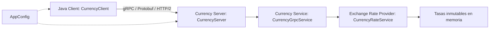
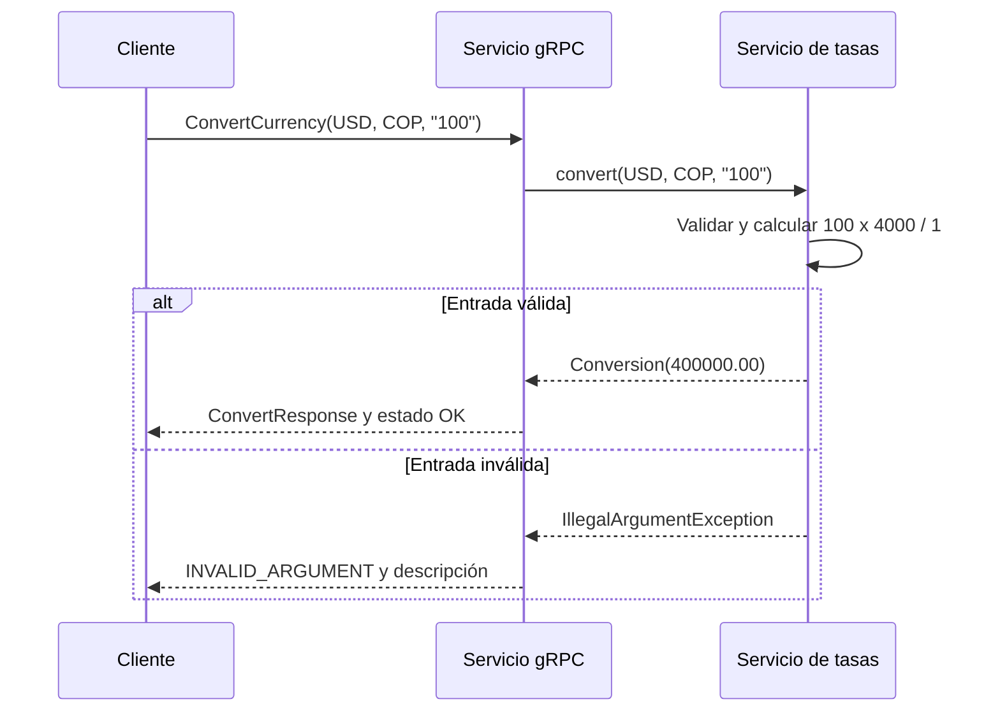
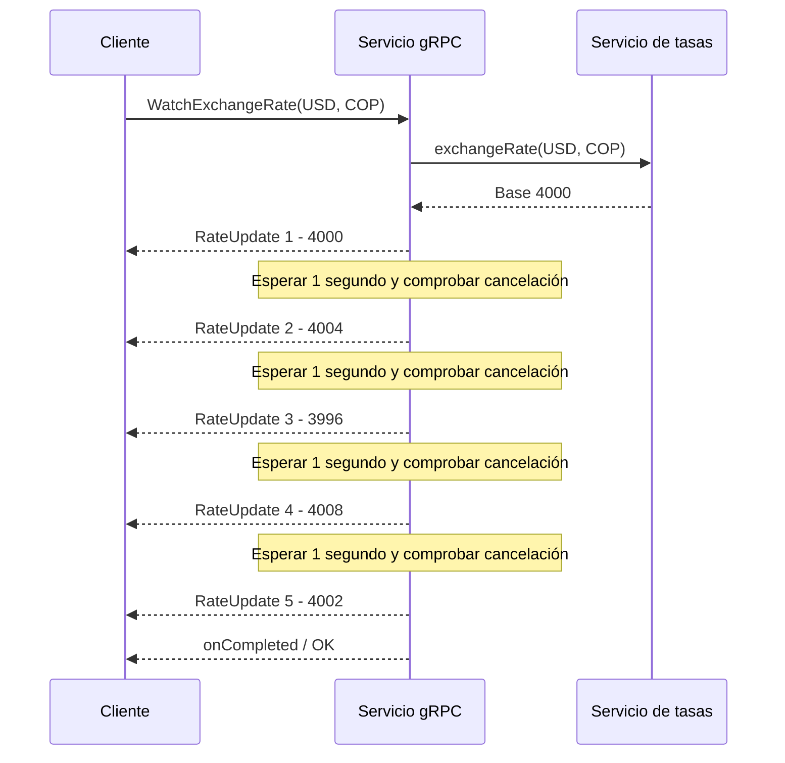
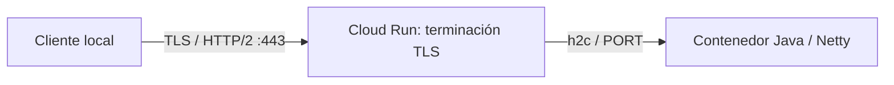

# Arquitectura de CurrencyRPC

## Arquitectura general

El cliente usa el stub bloqueante generado y presenta resultados. El servidor inicia Netty, asigna hilos virtuales y cierra recursos al apagar. El adaptador gRPC convierte errores de validación en `INVALID_ARGUMENT`. El servicio de tasas normaliza códigos y calcula con `BigDecimal`. No hay persistencia.

## Flujo unary

`GetSupportedCurrencies` también es unary y devuelve seis códigos en orden determinista.

## Flujo server streaming

La primera respuesta es inmediata. Un stream cancelado puede conservar su hilo virtual hasta el siguiente despertar, aproximadamente un segundo como máximo. Las variaciones no cambian las conversiones unary. El flujo está acotado a cinco mensajes pequeños por solicitud.

## Despliegue previsto

Localmente se usa h2c. En un despliegue real de Cloud Run, el cliente externo verificaría TLS y el contenedor no administraría certificados. Este diagrama es una arquitectura prevista: el despliegue no fue ejecutado por el requisito de facturación. Véase [despliegue simulado](despliegue-simulado.md). El proveedor de tasas del diagrama es la clase local `CurrencyRateService`, no un servicio externo.
