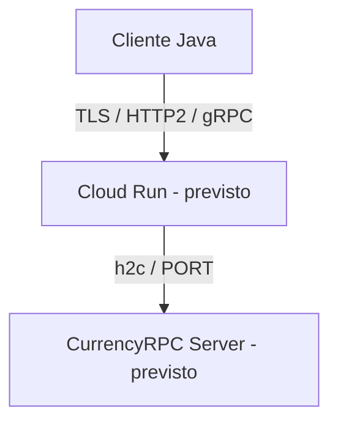

# Despliegue académico simulado — NO EJECUTADO

El despliegue real en Cloud Run no se realizó debido al requisito de vincular una cuenta de facturación. Para la demostración académica se documenta el procedimiento de despliegue y se simula la URL resultante.

No se ingresó una tarjeta ni se creó un servicio cloud para esta entrega. La simulación es documental: la ejecución comprobada corresponde exclusivamente a procesos locales.

## Plataforma y arquitectura esperadas

Plataforma objetivo: **Google Cloud Run**.



Cloud Run termina TLS; el contenedor atiende HTTP/2 sin TLS en `0.0.0.0:$PORT`. El servidor usa 9090 si `PORT` no existe. El cliente admite `GRPC_HOST`, `GRPC_PORT` y `GRPC_TLS`; localmente TLS es `false`, mientras que un servicio cloud real requeriría TLS y puerto 443. Esta configuración existe en `AppConfig`, `CurrencyServer` y `CurrencyClient`.

## Procedimiento real documentado, no ejecutado

Requeriría Google Cloud CLI, autenticación, proyecto con facturación activa, APIs de Cloud Run/Cloud Build/Artifact Registry y permisos de despliegue y compilación. No ejecutar estos pasos como parte de la demostración local. La política del proyecto debe permitir invocación pública.

Preparación, solo si en el futuro se decide realizar un despliegue real:

```shell
gcloud auth login
gcloud config set project TU_PROJECT_ID
gcloud services enable run.googleapis.com cloudbuild.googleapis.com artifactregistry.googleapis.com
```

Comando real para Bash, **no ejecutado**:

```bash
gcloud run deploy currency-rpc \
  --source . \
  --region us-central1 \
  --allow-unauthenticated \
  --use-http2
```

Equivalente para CMD o PowerShell, **no ejecutado**:

```shell
gcloud run deploy currency-rpc --source . --region us-central1 --allow-unauthenticated --use-http2
```

Con `--source .`, Cloud Build usaría el Dockerfile del proyecto. Cloud Run suministraría `PORT` (normalmente 8080 sin `--port`); el servidor lo lee, aunque el Dockerfile declare 9090 como valor local. También se puede añadir `--port 9090`. Habilitar HTTP/2 evita degradar el transporte. Los permisos requeridos se detallan en la [guía oficial de despliegue desde código](https://docs.cloud.google.com/run/docs/deploying-source-code); la terminación TLS y h2c se describen en la [guía oficial de HTTP/2](https://docs.cloud.google.com/run/docs/configuring/http2).

## URL simulada de despliegue académico

La siguiente URL es únicamente representativa y no corresponde a un servicio activo.

**URL SIMULADA, NO ACTIVA:** `https://currency-rpc-example-uc.a.run.app`

No se debe visitar ni usar como prueba de conectividad. No hay URL pública real en esta entrega.

Para una futura URL real, configurar en CMD (sustituir `HOST_REAL` por el host real, sin `https://`):

```bat
set GRPC_HOST=HOST_REAL
set GRPC_PORT=443
set GRPC_TLS=true
java -cp target/currency-rpc.jar com.currencyrpc.client.CurrencyClient
```

PowerShell, únicamente para un servicio real futuro:

```powershell
$env:GRPC_HOST = 'HOST_REAL'
$env:GRPC_PORT = '443'
$env:GRPC_TLS = 'true'
java -cp target/currency-rpc.jar com.currencyrpc.client.CurrencyClient
```

## Demo local tipo servicio remoto

Se ejecutan dos procesos independientes que se comunican por gRPC/HTTP2 en loopback. Esto demuestra la separación cliente-servidor, pero no prueba alojamiento cloud ni TLS público.

PowerShell, terminal 1:

```powershell
$env:PORT = '9090'
java -jar target/currency-rpc.jar
```

PowerShell, terminal 2:

```powershell
$env:GRPC_HOST = 'localhost'
$env:GRPC_PORT = '9090'
$env:GRPC_TLS = 'false'
java -cp target/currency-rpc.jar com.currencyrpc.client.CurrencyClient
```

CMD, terminal 1:

```bat
set PORT=9090
java -jar target/currency-rpc.jar
```

CMD, terminal 2:

```bat
set GRPC_HOST=localhost
set GRPC_PORT=9090
set GRPC_TLS=false
java -cp target/currency-rpc.jar com.currencyrpc.client.CurrencyClient
```

Ejecutar desde la raíz después de `mvn clean package`. Detener el servidor con Ctrl+C.

## Alcance de la evidencia

Los archivos [tests.txt](evidencias/tests.txt) y [ejecucion-local.txt](evidencias/ejecucion-local.txt) contienen salidas locales reales. No contienen resultados inventados del proveedor. Dockerfile preparado pero no ejecutado localmente porque Docker no está disponible en el entorno.
